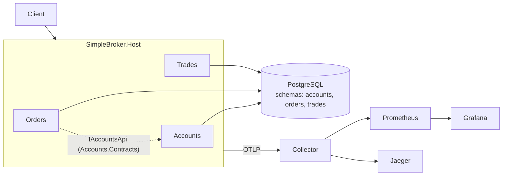

# Simple Broker

A deliberately simple stock-broker backend, built as a learning project for high-load .NET:
every technology is introduced only after a measurement shows the problem it solves.

**Status:** stage 2 in progress; results are recorded, but integration tests and load-test exit criteria are not yet met. See [`plans/`](plans/stage-02-accounts-transactions.md) for the current status and [`plans/`](plans/plan_highload_broker.md) for the roadmap.

## Architecture

Modular monolith: one deployable (`SimpleBroker.Host`), three modules, one PostgreSQL with a schema per module.



Modules talk to each other only through their `*.Contracts` project; this is enforced by tests
in `tests/SimpleBroker.ArchitectureTests` (see [ADR-0001](docs/adr/0001-modular-monolith.md)).

## API (stage 1)

| Method | Path | Notes |
|---|---|---|
| POST | `/accounts` | `{owner, currency}` -> 201 `{id}` |
| POST | `/accounts/{id}/deposit` | `{amount}` -> balance |
| GET | `/accounts/{id}/balance` | |
| POST | `/orders` | `{accountId, instrumentId, side, type, price, quantity}` -> 201, status `New` (no matching yet) |
| GET | `/accounts/{id}/trades?page=&size=` | naive OFFSET pagination, no secondary indexes (on purpose) |

## Quick start

```bash
docker compose up -d                       # postgres, otel-collector, jaeger, prometheus, grafana
tools/ef.sh add                            # once: generate "Initial" migrations, commit them
tools/ef.sh update                         # apply migrations
dotnet run -c Release --project tools/DataGen -- --scale S --seed 42
OTEL_EXPORTER_OTLP_ENDPOINT=http://localhost:4317 dotnet run -c Release --project src/SimpleBroker.Host
k6 run -e BASE_URL=http://localhost:5000 loadtests/baseline.js
```

UIs: Grafana http://localhost:3000, Jaeger http://localhost:16686, Prometheus http://localhost:9090.

Tests: `dotnet test` (integration tests need Docker; they start their own Postgres via Testcontainers).

## Stage log

| Stage | Problem found by measurement | Change | Result |
|---|---|---|---|
| 1 | - (baseline) | skeleton + observability | see [journal](docs/journal/01-skeleton.md) |
| 2 | Lost updates, overselling, deadlocks, and hot-account contention | atomic/locked/optimistic withdrawals, ordered transfers, reservations, transactional outbox | 10 architecture + 42 integration tests pass; C1 and C2 results plus an educational explanation are recorded; C3/L1′ measurements are still in progress, so `v0.2` is not yet tagged — see [journal](docs/journal/02-accounts-transactions.md) and [Russian learning report](docs/journal/stage-02-learning-report-ru.md) |
