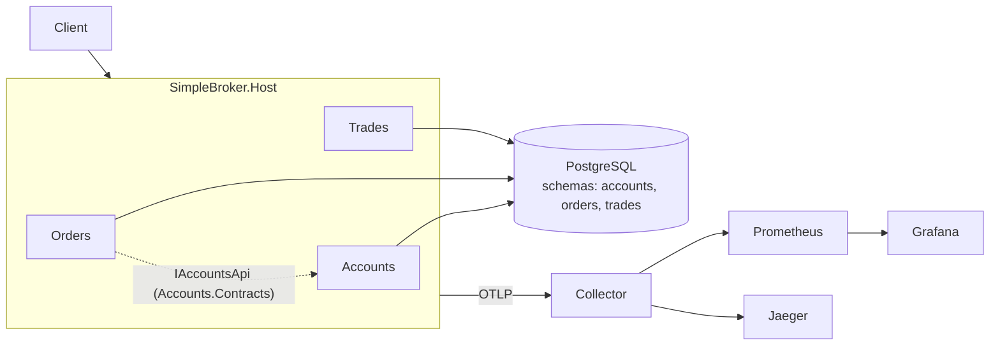

# Simple Broker

A deliberately simple stock-broker backend, built as a learning project for high-load .NET:
every technology is introduced only after a measurement shows the problem it solves.

**Status:** stage 1 (skeleton and baseline). See [`plans/`](plans/plan_highload_broker.md) for the roadmap.

## Architecture

Modular monolith: one deployable (`SimpleBroker.Host`), three modules, one PostgreSQL with a schema per module.



Modules talk to each other only through their `*.Contracts` project; this is enforced by tests
in `tests/SimpleBroker.ArchitectureTests` (see [ADR-0001](docs/adr/0001-modular-monolith.md)).

## API (stage 1)

| Method | Path | Notes |
|---|---|---|
| POST | `/accounts` | `{owner, currency}` -> 201 `{id}` |
| POST | `/accounts/{id}/deposit` | `{amount}` -> balance |
| GET | `/accounts/{id}/balance` | |
| POST | `/orders` | `{accountId, instrumentId, side, type, price, quantity}` -> 201, status `New` (no matching yet) |
| GET | `/accounts/{id}/trades?page=&size=` | naive OFFSET pagination, no secondary indexes (on purpose) |

## Quick start

PostgreSQL is published on host port **5433** (5432 is often taken by a local install).
Step-by-step instructions for a fresh machine (Windows/PowerShell): [`docs/RUNBOOK.md`](docs/RUNBOOK.md).

```powershell
docker compose up -d                                   # postgres, otel-collector, jaeger, prometheus, grafana
.\tools\ef.ps1 update                                  # apply migrations (tools/ef.sh on Linux/macOS)
dotnet run -c Release --project tools/DataGen -- --scale S --seed 42 --out loadtests/data
$env:OTEL_EXPORTER_OTLP_ENDPOINT="http://localhost:4317"; dotnet run -c Release --project src/SimpleBroker.Host --launch-profile http
k6 run -e BASE_URL=http://localhost:5000 loadtests/baseline.js
```

UIs: Grafana http://localhost:3000, Jaeger http://localhost:16686, Prometheus http://localhost:9090.

Tests: `dotnet test` (integration tests need Docker; they start their own Postgres via Testcontainers).

## Baseline numbers (stage 1, L1: 50 -> 300 rps ramp, medians of 3 runs, one machine)

| Dataset | Achieved rps | p50 | p95 | Errors |
|---|---|---|---|---|
| S (500k orders, 100k trades) | 207.7 (target met) | 5.6 ms | 10.4 ms | 0% |
| M (5M orders, 1M trades) | 41.1 (80% of load dropped) | 9.6 s | 22.6 s | 0% |

## Stage log

| Stage | Problem found by measurement | Change | Result |
|---|---|---|---|
| 1 | Baseline: dataset M falls from 208 to 41 rps and p95 reaches 22 s while S is fine (suspect: trades query without index, OFFSET) | skeleton + observability | [journal](docs/journal/01-skeleton.md) |
