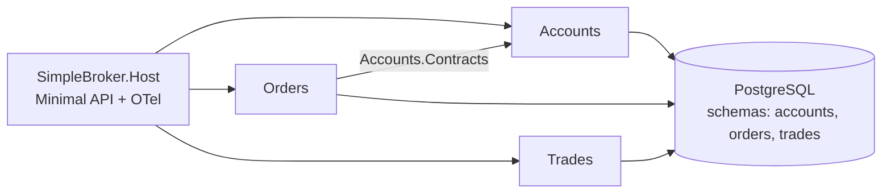
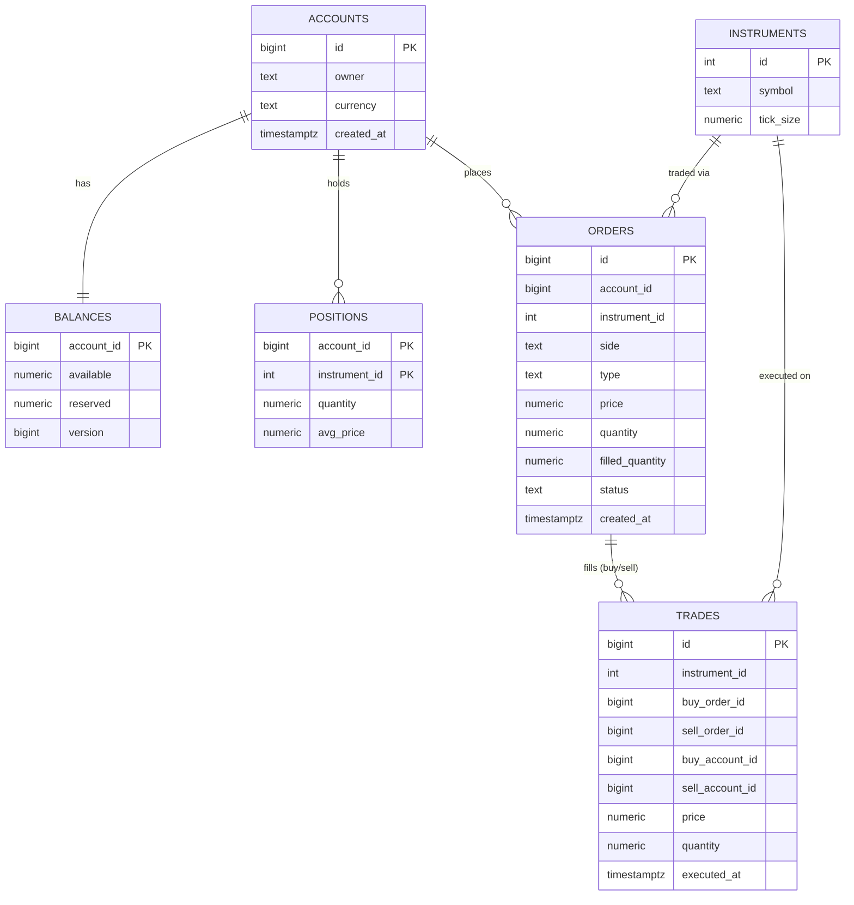

# stage-01-skeleton.md — Этап 1. Каркас: модульный монолит, наблюдаемость, baseline

> Обновлено: 2026-10-25 · Ветка: `stage-01` · Тег по завершении: `v0.1` · Статус: Проверен · Сроки: нед 1–2 (2026-10-20 → 2026-11-02) · Родитель: [plan_highload_broker.md](plan_highload_broker.md)

**Как читать:** разделы 0–3 и текущую сессию. Конфиги и скрипты (разделы 5–6) открываем, когда сессия до них дошла. Когда скрипт реализован в репозитории, здесь остаётся ссылка на путь, а не копия кода.

---

## 0. Цель и границы

**Цель:** рабочий модульный монолит на одной Postgres, сквозная наблюдаемость (метрики, трейсы, дашборд) и первый воспроизводимый нагрузочный замер: baseline, от которого отсчитываются все улучшения.

**Не делаем (намеренно):**
- Матчинг заявок (этап 5), резервирование средств и транзакционные гарантии (этап 2).
- Индексы сверх первичных ключей, keyset-пагинацию, кэш: проблемы должны проявиться в замерах, а чинить их будем на этапах 3 и 8.
- Аутентификацию, frontend, Kubernetes.

**Готово, когда:**
1. `docker compose up -d` поднимает Postgres, Collector, Jaeger, Prometheus, Grafana; API стартует и отдаёт метрики и трейсы.
2. `k6 run loadtests/baseline.js` выдаёт RPS/p50/p95/p99/ошибки; три прогона на масштабах S и M записаны в раздел 7.
3. Есть `docs/journal/01-skeleton.md`, ADR-0001 и ADR-0002 (на английском), ветка `stage/01-skeleton`, тег `v0.1`.

---

## 1. Решения этапа

| # | Решение | Почему |
|---|---|---|
| 1 | .NET LTS (10), Minimal API, solution `SimpleBroker.slnx` | Меньше церемоний, быстрее путь до замеров |
| 2 | Модули этапа: `Accounts`, `Orders`, `Trades`; каждый = проект реализации + проект `*.Contracts`; `MarketData`, `Files`, `Notifications` добавляем на своих этапах | Не плодим пустые модули |
| 3 | Одна БД, схема на модуль (`accounts`, `orders`, `trades`), свой `DbContext` на модуль, без FK между схемами | Позволяет позже вынести модуль в отдельную БД |
| 4 | Межмодульные вызовы только через `*.Contracts`; архитектурный тест (NetArchTest) это проверяет | Граница модуля должна быть исполняемым правилом |
| 5 | EF Core + Npgsql для записи и миграций; Dapper на горячих чтениях появится на этапе 3 для сравнения (по умолчанию, вопрос 2 основного плана) | Честное сравнение «до/после» |
| 6 | Деньги и количество: `numeric(28,8)` / `decimal`, `double` запрещён | Стандарт для финансовых данных |
| 7 | OTLP → OpenTelemetry Collector → Prometheus (метрики) и Jaeger (трейсы), Grafana сверху | Один стандартный контур, дальше только добавляем |
| 8 | Приложение в разработке запускаем на хосте (`dotnet run`), инфраструктуру в compose | Удобно отлаживать и подключать `dotnet-counters`; профиль `app` в compose добавим на этапе 8 |

---

## 2. Схемы

**Модули и зависимости**



**Логическая модель данных** (связи логические, FK между схемами не создаём)



Схемы БД: `accounts` (accounts, balances, positions), `orders` (instruments, orders), `trades` (trades). Выборка сделок счёта идёт по `buy_account_id = X OR sell_account_id = X` (намеренно: материал для этапа 3).

**API этапа**

| Метод | Путь | Назначение |
|---|---|---|
| POST | `/accounts` | создать счёт |
| POST | `/accounts/{id}/deposit` | пополнить баланс |
| GET | `/accounts/{id}/balance` | баланс |
| POST | `/orders` | выставить заявку (без матчинга, статус `New`) |
| GET | `/accounts/{id}/trades?page=N&size=50` | сделки счёта, OFFSET-пагинация |

---

## 3. Шаги: 14 сессий по ~2 часа

Недели 1–2. `[A]` — ассистент даёт каркас, ревью, объяснения; `[U]` — пишет пользователь.

- [x] **S1** (сделано [A]) [U] Создать репозиторий `simple-broker`, ветки `main` и `stage/01-skeleton`; скопировать в корень папку `plans/`. [A] Проверить `Directory.Build.props`, `.editorconfig`, `.gitignore`, структуру каталогов.
- [x] **S2** [A] Каркас solution и проектов модулей. [U] Реализовать пустые модули с `AddXxxModule(IServiceCollection)`, архитектурный тест на запрет ссылок на внутренности чужих модулей.
- [x] **S3** [U] `docker-compose.yml` и конфиги из раздела 5; проверить, что Prometheus, Grafana и Jaeger открываются.
- [x] **S4** [U] Подключить OpenTelemetry в Host (раздел 5.5); убедиться, что метрики видны в Prometheus, а трейс запроса в Jaeger.
- [x] **S5** [U] Сущности, `DbContext`-ы по модулям, первая миграция (схема из раздела 2). [A] Ревью типов и именования.
- [x] **S6** [U] Accounts: создать, пополнить, баланс. Интеграционные тесты на Testcontainers.
- [x] **S7** [U] Orders: валидация, проверка существования счёта через `Accounts.Contracts`, сохранение со статусом `New`.
- [x] **S8** [U] Trades: `GET /accounts/{id}/trades` с OFFSET-пагинацией (без доп. индексов, намеренно).
- [x] **S9** [A] Спецификация и каркас `tools/DataGen` (раздел 4). [U] Реализовать генерацию через Npgsql `COPY ... BINARY`.
- [x] **S10** [U] Прогнать генератор на масштабах S и M, записать время загрузки и размер БД (раздел 7).
- [x] **S11** [U] Скрипт `loadtests/baseline.js` (раздел 6), сохранить `loadtests/data/accounts.json`; собрать дашборд Grafana (список панелей в разделе 5.6).
- [x] **S12** [U] Три прогона L1 на S и M; параллельно `dotnet-counters`; записать цифры. [A] Помочь с интерпретацией.
- [x] **S13** (journal, ADR, README, `docs/RUNBOOK.md` заполнены цифрами машины A [A]; p99 и машина B — после повторных прогонов) [U] `docs/journal/01-skeleton.md`, ADR-0001 (modular monolith), ADR-0002 (observability stack), README (EN) со скелетом. [A] Ревью английского и структуры.
- [x] **S14** Чистый запуск проверен: удалены volumes через `docker compose down -v`, стек поднят заново, миграции применены, S-данные загружены, `GET /accounts/1/balance` вернул HTTP 200; полный набор тестов прошёл (27/27); статусы планов обновлены. Git-тег `v0.1` будет создан после коммита и слияния этапа в `main`.

**Как проверить:**
- Чистый клон → `docker compose up -d` → `dotnet run --project src/SimpleBroker.Host` → `GET /accounts/1/balance` отвечает 200.
- Нарушить правило модулей (ссылка на чужой internal) → архитектурный тест падает.
- Остановить k6 на середине → в Grafana видна кривая RPS и p95 за прогон.

---

## 4. Данные и генератор

**Масштабы**

| Масштаб | Accounts | Instruments | Orders | Trades | Назначение |
|---|---|---|---|---|---|
| S | 10k | 100 | 500k | 100k | быстрые прогоны, отладка |
| M | 100k | 500 | 5M | 1M | основной baseline |
| L (опц.) | 1M | 1000 | 50M | 10M | только замер времени загрузки; полноценно используем с этапа 3 |

**Распределения:** популярность инструментов по Zipf (s ≈ 1.1), активность счетов по Pareto (20% счетов дают ~80% сделок), время сделок равномерно за последние 12 месяцев. Фиксированный `--seed` для воспроизводимости.

**CLI:** `dotnet run -c Release --project tools/DataGen -- --scale M --seed 42 --connection "<cs>" --out loadtests/data`

**Порядок:** миграции применены → `TRUNCATE` → instruments → accounts + balances → orders → trades (только PK, вторичных индексов нет) → `ANALYZE` → запись `accounts.json` (10k случайных id) → вывод времени по фазам.

**Скелет загрузки:**

```csharp
await using var writer = await conn.BeginBinaryImportAsync(
    "COPY trades.trades (id, instrument_id, buy_order_id, sell_order_id, " +
    "buy_account_id, sell_account_id, price, quantity, executed_at) FROM STDIN (FORMAT BINARY)");

for (long i = 1; i <= count; i++)
{
    await writer.StartRowAsync();
    await writer.WriteAsync(i, NpgsqlDbType.Bigint);
    await writer.WriteAsync(instrumentId, NpgsqlDbType.Integer);
    // ... остальные поля; decimal -> NpgsqlDbType.Numeric, UTC DateTime -> NpgsqlDbType.TimestampTz
}
await writer.CompleteAsync();
```

---

## 5. Инфраструктура и инструкции

Версии образов ниже рабочие, но не самые свежие: на S3 проверить актуальные теги на Docker Hub и зафиксировать.

### 5.1 `docker-compose.yml`

```yaml
services:
  postgres:
    image: postgres:17
    environment:
      POSTGRES_USER: broker
      POSTGRES_PASSWORD: broker
      POSTGRES_DB: broker
    command: ["postgres", "-c", "shared_preload_libraries=pg_stat_statements",
              "-c", "pg_stat_statements.track=all", "-c", "max_connections=200"]
    ports: ["5433:5432"]   # 5433: порт 5432 часто занят локальным Postgres
    cpus: 2          # подобрать под машину и зафиксировать в journal
    mem_limit: 4g
    volumes:
      - pgdata:/var/lib/postgresql/data
      - ./infra/postgres-init.sql:/docker-entrypoint-initdb.d/init.sql:ro
    healthcheck:
      test: ["CMD-SHELL", "pg_isready -U broker -d broker"]
      interval: 5s
      retries: 10

  otel-collector:
    image: otel/opentelemetry-collector-contrib:0.114.0
    command: ["--config=/etc/otelcol/config.yaml"]
    volumes: ["./infra/otel-collector.yaml:/etc/otelcol/config.yaml:ro"]
    ports: ["4317:4317", "4318:4318", "8889:8889"]
    depends_on: [jaeger]

  jaeger:
    image: jaegertracing/all-in-one:1.62.0
    environment: { COLLECTOR_OTLP_ENABLED: "true" }
    ports: ["16686:16686"]

  prometheus:
    image: prom/prometheus:v2.55.1
    volumes: ["./infra/prometheus.yml:/etc/prometheus/prometheus.yml:ro"]
    ports: ["9090:9090"]

  grafana:
    image: grafana/grafana:11.3.0
    environment:
      GF_AUTH_ANONYMOUS_ENABLED: "true"
      GF_AUTH_ANONYMOUS_ORG_ROLE: Admin
    volumes:
      - ./infra/grafana/provisioning:/etc/grafana/provisioning:ro
      - grafana-data:/var/lib/grafana
    ports: ["3000:3000"]

volumes:
  pgdata:
  grafana-data:
```

### 5.2 `infra/postgres-init.sql`

```sql
CREATE EXTENSION IF NOT EXISTS pg_stat_statements;
```

### 5.3 `infra/otel-collector.yaml` и `infra/prometheus.yml`

```yaml
# otel-collector.yaml
receivers:
  otlp:
    protocols:
      grpc: { endpoint: 0.0.0.0:4317 }
      http: { endpoint: 0.0.0.0:4318 }
processors:
  batch: {}
exporters:
  prometheus: { endpoint: 0.0.0.0:8889 }
  otlp/jaeger:
    endpoint: jaeger:4317
    tls: { insecure: true }
service:
  pipelines:
    metrics: { receivers: [otlp], processors: [batch], exporters: [prometheus] }
    traces:  { receivers: [otlp], processors: [batch], exporters: [otlp/jaeger] }
```

```yaml
# prometheus.yml
global: { scrape_interval: 5s }
scrape_configs:
  - job_name: otel-collector
    static_configs: [{ targets: ["otel-collector:8889"] }]
```

### 5.4 `infra/grafana/provisioning/datasources/ds.yml`

```yaml
apiVersion: 1
datasources:
  - { name: Prometheus, type: prometheus, access: proxy, url: "http://prometheus:9090", isDefault: true }
  - { name: Jaeger, type: jaeger, access: proxy, url: "http://jaeger:16686" }
```

### 5.5 OpenTelemetry в Host

Пакеты: `OpenTelemetry.Extensions.Hosting`, `OpenTelemetry.Instrumentation.AspNetCore`, `OpenTelemetry.Instrumentation.Http`, `OpenTelemetry.Instrumentation.Runtime`, `OpenTelemetry.Exporter.OpenTelemetryProtocol`, `Npgsql.OpenTelemetry`.

```csharp
builder.Services.AddOpenTelemetry()
    .ConfigureResource(r => r.AddService("simple-broker"))
    .WithMetrics(m => m
        .AddAspNetCoreInstrumentation()
        .AddHttpClientInstrumentation()
        .AddRuntimeInstrumentation()
        .AddNpgsqlInstrumentation()
        .AddMeter("SimpleBroker.*")
        .AddOtlpExporter())
    .WithTracing(t => t
        .AddAspNetCoreInstrumentation()
        .AddNpgsql()
        .AddSource("SimpleBroker.*")
        .AddOtlpExporter());
```

Эндпоинт задаётся переменной `OTEL_EXPORTER_OTLP_ENDPOINT=http://localhost:4317`. Свои метрики и спаны модулей: `Meter`/`ActivitySource` с именем `SimpleBroker.<Module>`.

### 5.6 Дашборд Grafana (панели)

RPS (`rate(http_server_request_duration_seconds_count[1m])`), p50/p95/p99 (`histogram_quantile(0.95, sum by (le) (rate(http_server_request_duration_seconds_bucket[1m])))`), доля 5xx, GC-коллекции по поколениям, размер кучи/LOH, длина очереди пула потоков, активные соединения Npgsql. Точные имена runtime-метрик зависят от версии инструментации: сверить в Prometheus UI (`/graph` → поиск по `dotnet_` и `process_`). Готовый дашборд экспортировать в `infra/grafana/dashboards/` и подключить provisioning'ом.

### 5.7 Команды

```bash
docker compose up -d
dotnet ef database update -p src/SimpleBroker.Accounts -s src/SimpleBroker.Host -c AccountsDbContext   # так же для Orders, Trades
dotnet run -c Release --project tools/DataGen -- --scale M --seed 42 --connection "Host=localhost;Port=5433;Username=broker;Password=broker;Database=broker" --out loadtests/data
OTEL_EXPORTER_OTLP_ENDPOINT=http://localhost:4317 dotnet run -c Release --project src/SimpleBroker.Host
k6 run -e BASE_URL=http://localhost:5000 loadtests/baseline.js
dotnet-counters monitor --process-id <pid> System.Runtime Microsoft.AspNetCore.Hosting
```

Прогоны только в Release и на прогретом приложении. Перед каждым прогоном: `ANALYZE` и 2–3 минуты прогрева обязательны.

---

## 6. Кейсы нагрузочного тестирования

| ID | Сценарий | Профиль | Метрики | Цель | Скрипт |
|---|---|---|---|---|---|
| L1 | baseline-mix: 20% `POST /orders`, 50% `GET trades`, 30% `GET balance` | ramping-arrival-rate 50→300 rps, ~6,5 мин | RPS, p50/p95/p99, ошибки, CPU app/PG, GC | зафиксировать baseline (ошибки < 1%) | `loadtests/baseline.js` |
| L2 | чтение сделок с разной глубиной страницы | 200 rps, 3 мин, page ∈ 1..50 | p95 от номера страницы | показать деградацию OFFSET (используется на этапе 3) | `loadtests/trades-read.js` |
| L3 | только запись заявок | 100/200/400 rps по 2 мин | latency вставки, активные соединения | найти порог записи | `loadtests/orders-write.js` |
| L4 | ступенчатый стресс | +100 rps каждые 2 мин до деградации | точка излома, что насыщается первым | где «колено» | `loadtests/stress-step.js` |

**Черновик `loadtests/baseline.js`:**

```javascript
import http from 'k6/http';
import { check } from 'k6';
import { SharedArray } from 'k6/data';

const accounts = new SharedArray('accounts', () => JSON.parse(open('./data/accounts.json')));
const BASE = __ENV.BASE_URL || 'http://localhost:5000';
const JSON_HDR = { headers: { 'Content-Type': 'application/json' } };

export const options = {
  scenarios: {
    mixed: {
      executor: 'ramping-arrival-rate',
      startRate: 50, timeUnit: '1s', preAllocatedVUs: 100, maxVUs: 500,
      stages: [
        { target: 100, duration: '1m' },
        { target: 300, duration: '3m' },
        { target: 300, duration: '2m' },
        { target: 0, duration: '30s' },
      ],
    },
  },
  thresholds: { http_req_failed: ['rate<0.01'], http_req_duration: ['p(95)<1000'] },
};

export default function () {
  const id = accounts[Math.floor(Math.random() * accounts.length)];
  const r = Math.random();
  let res;
  if (r < 0.2) {
    res = http.post(`${BASE}/orders`, JSON.stringify({
      accountId: id, instrumentId: 1 + Math.floor(Math.random() * 100),
      side: Math.random() < 0.5 ? 'Buy' : 'Sell', type: 'Limit',
      price: 100 + Math.random() * 10, quantity: 1 + Math.floor(Math.random() * 100),
    }), JSON_HDR);
  } else if (r < 0.7) {
    res = http.get(`${BASE}/accounts/${id}/trades?page=${1 + Math.floor(Math.random() * 20)}&size=50`);
  } else {
    res = http.get(`${BASE}/accounts/${id}/balance`);
  }
  check(res, { 'status 2xx': (x) => x.status >= 200 && x.status < 300 });
}
```

---

## 7. Результаты замеров

**Окружение (заполнить один раз):** CPU / RAM / диск, ОС, лимиты Docker, версии .NET и Postgres.

**Загрузка данных**

| Масштаб | Время по фазам | Размер БД | Заметки |
|---|---|---|---|
| S | truncate 0.0 · instruments 0.1 · accounts 0.1 · balances 0.1 · orders 1.3 · trades 0.2 · analyze 0.3 · итого 2.1 с | 77 MB | seed 42, Postgres на порту 5433 |
| M | truncate 0.0 · instruments 0.1 · accounts 0.3 · balances 0.3 · orders 7.1 · trades 2.4 · analyze 1.6 · итого 11.8 с | 693 MB | seed 42 |

**Прогоны**

| # | Кейс | Масштаб | Цель RPS | Факт RPS | p50 | p95 | p99 | Ошибки | CPU app / PG | Что насытилось первым |
|---|---|---|---|---|---|---|---|---|---|---|
| 1 | L1 | S | 50→300 (ср. 207.7) | 207.3 | 6.15 ms | 18.77 ms | н/д | 0.00% | н/д | не насытилось; max 4.06 s (холодный старт), dropped 151 |
| 2 | L1 | S | 50→300 (ср. 207.7) | 207.7 | 5.59 ms | 10.40 ms | н/д | 0.00% | н/д | не насытилось; dropped 0 |
| 3 | L1 | S | 50→300 (ср. 207.7) | 207.7 | 5.07 ms | 10.06 ms | н/д | 0.00% | н/д | не насытилось; dropped 0 |
| **мед. S** | L1 | S | | 207.7 | 5.59 ms | 10.40 ms | н/д | 0.00% | н/д | цель достигнута |
| 4 | L1 | M | 50→300 (ср. 207.7) | 40.8 | 9.64 s | 22.69 s | н/д | 0.00% | н/д | dropped 64 812 (80%), 500 VU исчерпаны |
| 5 | L1 | M | 50→300 (ср. 207.7) | 41.1 | 9.67 s | 22.57 s | н/д | 0.00% | н/д | dropped 64 672 (80%) |
| 6 | L1 | M | 50→300 (ср. 207.7) | 42.4 | 9.28 s | 21.99 s | н/д | 0.00% | н/д | dropped 64 188 (79%) |
| **мед. M** | L1 | M | | 41.1 | 9.64 s | 22.57 s | н/д | 0.00% | н/д | **порог p95<1 s провален**; гипотеза: GET trades (OR по двум колонкам, без индекса) + OFFSET на 1M строк упирается в CPU Postgres (2 CPU); не подтверждена: нет CPU/pg_stat_statements под нагрузкой |

**Окружение:** .NET SDK 10.0.402; Docker 15.38 GiB RAM, Postgres 17 в контейнере (cpus 2, mem 4g); k6 и API на той же машине. Модель CPU и диск дописать.
**Пробелы:** p99 нет (k6 по умолчанию не печатает): `summaryTrendStats` с `p(99)` уже добавлен в `loadtests/*.js`, цифры появятся при повторных прогонах на машине B (результаты машин A и B не смешиваем). CPU app/PG под нагрузкой не снят: шаги F4-F5 в `docs/RUNBOOK.md`.

---

## 8. Риски и вопросы этапа

| # | Что | Действие |
|---|---|---|
| 1 | Слабая машина искажает замеры | Фиксировать окружение, сравнивать только внутри одной машины |
| 2 | Шум от фоновых процессов | Закрыть лишнее, 3 прогона, брать медиану |
| 3 | Соблазн «сразу сделать правильно» (индексы, кэш) | Не делаем: это содержимое этапов 3 и 8 |

---

## Итог

Каркас модульного монолита, инфраструктура наблюдаемости, генератор данных и baseline L1 для S и M готовы.
Три дополнительных M-прогона на машине B и диагностика подтвердили насыщение PostgreSQL на медленном запросе истории сделок; оптимизация остаётся в этапе 3.
После удаления Docker volumes чистый запуск прошёл, миграции применились, S-данные загрузились, smoke test вернул HTTP 200, все 27 тестов прошли.
Тег `v0.1` будет поставлен после коммита и слияния ветки этапа в `main`.
