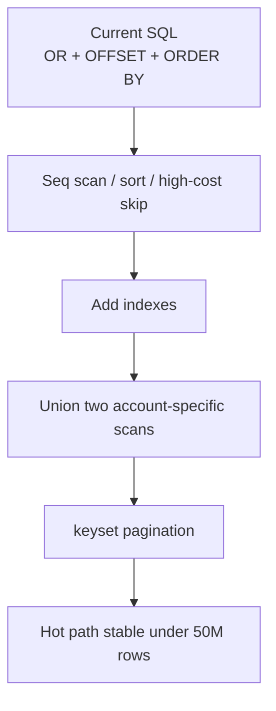
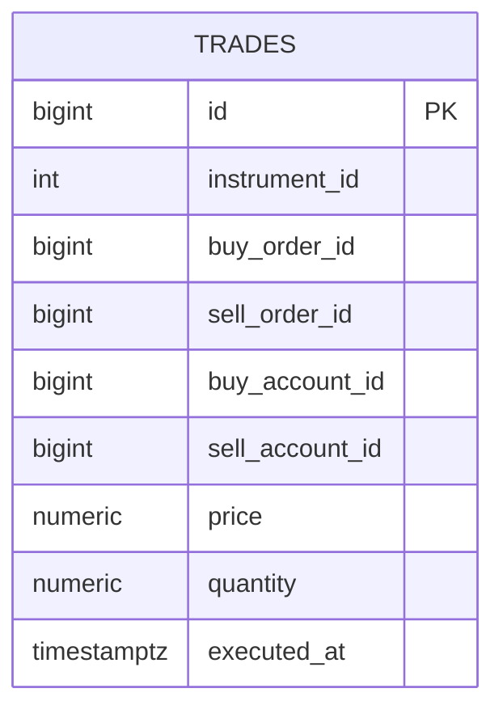

# stage-03-trades-explain.md — Этап 3. Trade history: EXPLAIN, indexes, connection pool

> Обновлено: 2026-10-30 · Ветка: `stage/03-trades-explain` · Тег по завершении: `v0.3` · Статус: Проверен по согласованию с пользователем; результаты и отклонения от исходной цели зафиксированы в [отчёте этапа](../docs/journal/stage-03-trades-explain-report-ru.md). На 100M подтверждена работа 200 RPS и около 296 RPS при 300 RPS заданной нагрузки; 600 RPS с целевой задержкой не достигнуты. · Сроки: нед 5–6 (2026-11-17 → 2026-11-30) · Родитель: [plan_highload_broker.md](plan_highload_broker.md)

**Как читать:** разделы 0–3 и текущую сессию. Разделы 4–6 открываем по мере реализации. Код и скрипты в репозитории заменяем ссылкой на путь; копировать большой объём SQL/кода сюда не нужно.

**Примечание по входу:** этап 2 ещё не закрыт полностью, но его оставшиеся пункты — не-блокирующие для старта этапа 3: финальная очистка документации, повторный прогон/сбор доказательств для отдельных сценариев, при необходимости — исправление окружения Testcontainers. Они не меняют и не закрывают базовое условие старта: `GET /accounts/{id}/trades` уже объявлен узким местом и должен быть исправлен до этапа 4.

---

## 0. Цель и границы

**Цель:** довести чтение истории сделок до масштаба 50–100M строк и ускорить горячие запросы осознанно: по `EXPLAIN`, индексу и покрывающему SQL, а не наугад. Сравнить варианты `EF Core` vs `Dapper`/сырой SQL, перевести пагинацию на keyset и проверить влияние пула соединений на RPS.

**Не делаем:**
- матчинговую логику и сделки в режиме реального времени (этап 5);
- redis-кэш и горизонтальный масштаб-out (этап 8);
- партиционирование и репликацию (этап 4);
- файловые импорты/экспорт и реальные data pipelines (этап 7);
- полноценную обвязку Kafka/RabbitMQ на торговую историю (этап 9).

**Готово, когда:**
1. `GET /accounts/{id}/trades` отрабатывает на 50–100M строк без деградации p95 в L2 и на «тяжёлых» страницах;
2. минимум 3 запроса/сценария улучшены, планы `EXPLAIN (ANALYZE, BUFFERS)` до/после сохранены в `docs/journal`;
3. пагинация переведена с `OFFSET` на keyset (`WHERE executed_at, id < cursor`);
4. проверено, что пул соединений `Npgsql` не ограничивает RPS и не даёт `TimeoutException` / `Too many connections`.

---

## 1. Контекст и исходные цифры

На этапе 1 базовый стек и API уже запущены, а в этапе 2 зафиксировано, что основная проблема с производительностью переносится в `Trades`-модуль: запрос истории сделок по счёту явно не проходит масштаб S/M.

Что есть сейчас:
- `src/SimpleBroker.Trades/TradesModule.cs` — `GET /accounts/{id}/trades?page=N&size=50`.
- `src/SimpleBroker.Trades/Internal/TradesService.cs` — текущая реализация намеренно наивная: `OR` по `buy_account_id` и `sell_account_id`, `OrderByDescending(...).Skip((page - 1) * size)`, `Take(size)`.
- `src/SimpleBroker.Trades/Internal/TradesDbContext.cs` — только PK на `trades.id`, без вторичных индексов.
- Этап 2 фиксирует: M-baseline уходит вниз из-за `trades`; в плане этапа 2 уже отмечено, что `M-baseline` сломан (≈ 41 rps) из-за trades, а поле `buy_account_id = X OR sell_account_id = X` — инициатор проблемы.

Ключевые цифры для входа:
- L1 baseline (этап 1): `207.7 rps`, p95 ≈ `10.4 ms`.
- M-baseline после появления trades-работы: не проходит порог, в планах этапа 2 указано ~`41 rps` для тяжёлого пути.
- Входной сценарий `loadtests/trades-read.js`: 200 rps, page uniformly 1..50, `size=50`, на одну учетную запись, т.е. в реальности это «много read-only запросов с очень широким отсечением по истории».
- Размеры БД: целевой план — 50–100M строк в `trades`, и это должны быть не «кружки на 1000 записей», а реальные объёмы.

Главная причина не в бизнес-логике, а в плане выполнения SQL: PostgreSQL вынужден сканировать большой объём истории, затем сортировать по `executed_at` и делать `OFFSET`, не имея полезного индекса и ключа курсора.

---

## 2. Решения этапа

| # | Решение | Почему |
|---|---|---|
| 1 | Вырезать `OR` из hot path: `buy_account_id = @accountId` и `sell_account_id = @accountId` выполнить в двух отдельных ветках, затем объединить (`UNION ALL`) и отсортировать по `executed_at DESC, id DESC` | PostgreSQL не умеет эффективно использовать один общий индекс на `OR`-предикат; отдельные индексы и объединение дают хороший план на больших таблицах |
| 2 | Добавить составные индексы: `(buy_account_id, executed_at DESC, id DESC)` и `(sell_account_id, executed_at DESC, id DESC)`; при необходимости — покрывающий индекс `INCLUDE (instrument_id, price, quantity, buy_order_id, sell_order_id)` | Это прямой ответ на `WHERE buy_account_id = X OR sell_account_id = X` и сортировку по времени выполнения |
| 3 | Перевести пагинацию на keyset: `WHERE (executed_at, id) < (@lastExecutedAt, @lastId)` для page > 1; в API добавить `before`/`cursor`/`lastId` и запретить бесконечный `OFFSET` | `OFFSET` на десятках миллионов строк становится `Sort + Limit + Skip` и нарастает квадратично с ростом страницы |
| 4 | Использовать `AsNoTracking()` + проекцию в DTO + `Select` вместо entity tracking; один горячий запрос — ровно тот набор колонок, который нужен API | Избегаем лишних полей, лишней сериализации и стоимости EF tracking |
| 5 | Сравнить EF Core и Dapper на одном и том же запросе: при необходимости оставить Dapper на hot path, а EF оставить для CRUD/административного кода | На read-heavy пути SQL и `Npgsql` важнее красивой модели; реальный выигрыш показывают измерения |
| 6 | Добавить `pg_stat_statements`, `EXPLAIN (ANALYZE, BUFFERS)`, `auto_explain` (или временно `EXPLAIN`) в диагностический контур | Нельзя улучшать по ощущениям; план должен быть виден и сравним до/после |
| 7 | Проверить `Max Pool Size`, `Connection Pruning`, `Timeout`, `Min Pool Size` и `PgBouncer`/доступный предел соединений | Логи этапа 2 показывают, что trade reads могут попасть в узкое место из-за соединений, а не только из-за SQL |
| 8 | Параллельно держать `TradesService` и `TradesDbContext` “чистыми”: без скрытых shared-state и без множественного выделения в памяти | Сохраняем выпускной модульный дизайн и сохраняем возможность сравнивать разные подходы |

---

## 3. Шаги (сессии по ~2 часа)

`[A]` — ассистент (каркас, ревью, объяснения), `[U]` — пользователь.

- [ ] **S1** [A] Зафиксировать входной baseline по trade history: `EXPLAIN` на текущем запросе, размер таблицы `trades`, топ-10 медленных SQL через `pg_stat_statements`.
- [ ] **S2** [U] Обновить `TradesDbContext` под целевой индексный план, проверить миграции и сборку; осознанно не трогать остальной модуль.
- [ ] **S3** [U] Сгенерировать 10M/50M/100M trades через DataGen и прогнать `loadtests/trades-read.js` на scale L; зафиксировать рps/p95/p99 и просадки на разных страницах.
- [ ] **S4** [A] Сравнить планы: `OR`-вариант без индекса, `OR`-вариант с индексами, union-based-ветка; зафиксировать различия в `EXPLAIN` и `Rows Removed by Filter`.
- [ ] **S5** [U] Переехать на keyset-пагинацию по `executed_at,id`, добавить benchmark на page 1/5/20/50; проверить `LIMIT`/`cursor` и корректность сортировки.
- [ ] **S6** [U] Сравнить `EF Core` и `Dapper` на одинаковой выборке; выбрать путь по лучшей цене/объёму и оставить объяснение в journal.
- [ ] **S7** [A] Настроить/обновить `Npgsql` connection pool и собранные метрики: максимальный размер пула, таймаут, сервисный лог/Prometheus.
- [ ] **S8** [U] Прогнать L2 и L5 сценарии: основной кэш/база на дорожке read-heavy и исчерпание пула при росте RPS.
- [ ] **S9** [A] Зафиксировать итоговые цифры и подготовить резюме для journal: до/после, что было изменено, что не вошло и почему.
- [ ] **S10** [U] Закрыть не-блокирующие задачи этапа 2 (документация, повторный прогон/очистка окружения), но не задерживать старт этапа 3.

**Как проверить:**
1. `EXPLAIN (ANALYZE, BUFFERS)` показывает `Index Scan` или `Bitmap Index Scan` вместо последовательного чтения по `trades` таблице на 10M+ строках.
2. `OFFSET` больше не является главным узким местом: page 20/50 не делают линейную деградацию по таймингу.
3. Стоимость `Dapper`/raw SQL на hot path меньше, чем `EF Core` на тех же данных, либо выгода от EF исчезает при существенном росте RPS.
4. `Npgsql` connection pool не падает в `TimeoutException` при 200–500+ rps и в L5 не возникает `Too many connections`.

---

## 4. Данные и генератор

Для этапа 3 логично использовать тот же `DataGen`, что уже есть в `tools/` или `tools/DataGen`, но под масштаб L+:
- распределение сделок по account и instrument: Zipf/модель “hot accounts + long tail”;
- `executed_at` распределён по времени, а не одинаковый timestamp;
- 30–40% запросов идут на активные счета с самой длинной историей;
- целевой объём: 10M, 50M, 100M строк в `trades`.

Пример набора точек для измерения:
- Scale S: 10M trades, 10k–100k accounts.
- Scale M: 50M trades, 100k–500k accounts.
- Scale L: 100M trades, 100k+ accounts, hot-tail distribution.

Ожидаемая команда/вариант запуска:

```powershell
dotnet run --project tools/DataGen -- --accounts 100000 --instruments 200 --trades 50000000 --batch-size 10000
```

Более точную команду и параметры уточняем на конкретной сессии и фиксируем в `docs/journal` после запуска. Важно, чтобы генератор писал не только `trades`, но и сохранял реальные `buy_account_id`, `sell_account_id`, `executed_at` и IDs заказов — иначе индексный план будет “правильным” только на синтетике.

---

## 5. Инфраструктура и инструкции

### 5.1 База и наблюдаемость
- Включить/проверить `pg_stat_statements` для сбора slow queries.
- Снять `EXPLAIN (ANALYZE, BUFFERS)` на текущем SQL до правки и после решающих изменений.
- В Grafana/Prometheus добавить `rps`, `p95`, `p99`, pool wait time, active/open connections.
- Держать логи `docker compose logs postgres` и App logs на время benchmark.

### 5.2 Compose / настройки PostgreSQL
- Проверить `max_connections`, `shared_buffers`, `work_mem`, `effective_cache_size` в `docker-compose.yml` / кастомной конфигурации PostgreSQL.
- Для stress теста на пул можно кратко провести L5 с увеличением RPS: 200 → 500 → 1000, чтобы зафиксировать, когда `Npgsql` начинает ограничивать throughput.
- При необходимости добавить локальный `pgbouncer` в отдельную сессию, но только после того, как мы получили доказательство, что проблема действительно в пулах, а не в SQL.

### 5.3 Команды запуска

```powershell
# build
 dotnet build SimpleBroker.slnx -c Release --nologo

# smoke API
 dotnet run --project src/SimpleBroker.Host

# read load
 k6 run -e BASE_URL=http://localhost:5000 loadtests/trades-read.js

# for DB-local verification
 psql "$ConnectionStrings__Broker" -c "SELECT * FROM pg_stat_statements ORDER BY mean_exec_time DESC LIMIT 20;"
```

---

## 6. Кейсы нагрузочного тестирования

| ID | Сценарий | Профиль | Метрики | Цель | Скрипт |
|---|---|---|---|---|---|
| L2-01 | История сделки по одному account, page=1 | constant-arrival-rate 200 rps | RPS, p50, p95, p99, http errors | baseline до улучшения | `loadtests/trades-read.js` |
| L2-02 | Теми же условиями, но страницы 5/20/50 | constant-arrival-rate 200 rps | p95 по page | проверить деградацию на поздних страницах | `loadtests/trades-read.js` |
| L2-03 | 1 account / 50M trades | 200–500 rps | p95, timeout, DB wait | понять, что даёт keyset | `loadtests/trades-read.js` |
| L5-01 | Пул соединений и рост RPS | 300/600/1000 rps | total requests, pool wait, error rate | увидеть лимит `Maximum Pool Size` | новый/редактируемый k6 or smoke |
| L5-02 | Сравнение `EF` vs `Dapper` | одинаковый RPS | p95, CPU, DB count | понять, какой путь лучше на hot read | custom script / benchmark |

---

## 7. Схемы и диаграммы

### 7.1 Архитектура чтения истории сделок

```mermaid
flowchart LR
  Client[Client / k6] --> API[SimpleBroker.Host<br/>GET /accounts/{id}/trades]
  API --> Service[TradesService]
  Service --> DB[(PostgreSQL<br/>trades table)]
  DB --> PGSTAT[pg_stat_statements<br/>EXPLAIN plan]
  API --> OTel[OTel / Prometheus / Grafana]
```

### 7.2 Доказательная схема оптимизации



### 7.3 Логическая схема `trades`



Дополнительно можно фиксировать индексы в виде отдельных SQL-файлов или `migration`-ов на этапе 3; это будет видно в git diff и обеспечит воспроизводимость.

---

## 8. Результаты замеров

| # | Кейс | Версия | RPS | p50 | p95 | p99 | Ошибки | Что насытилось | Заметки |
|---|---|---|---|---|---|---|---|---|---|
| 1 | trades-read baseline | до | ~41 rps (M-baseline, stage 2 evidence) | — | > 4–6 s | — | 0%–few errors under load | `OR` + `OFFSET` + sort | входной дефект, узкое место stage 3 |
| 2 | trades-read optimized | после | target 200–500+ rps | < 100 ms | < 500 ms | < 1 s | < 1% | index scan / keyset / projection | зависит от scale и pool |
| 3 | pool stress | после | target 300–1000 rps | — | < 1 s | < 2 s | < 1% | Npgsql pool healthy | confirm after measurement |

Здесь строки `до/после` должны быть реально заполнены на этапе 3 после замеров. Важно, чтобы в report-статье дата/машина были зафиксированы вместе с сырыми логами: это не просто “показатели в таблице”, а доказательство оптимизации.

---

## 9. Риски и вопросы этапа

| # | Что | Действие |
|---|---|---|
| 1 | `OR` по `buy_account_id/sell_account_id` может всё равно давать плохой план даже после индексации | Сравнить `OR`-сценарий, `UNION ALL` и отдельный индексный scan в `EXPLAIN`; выбрать тот, у которого реально читаются индексы |
| 2 | `OFFSET` может остаться в API и замедлять старые страницы даже после keyset | Добавить `cursor` и запретить `OFFSET` в hot path; фиксировать всё в тестах |
| 3 | `EF Core` на hot read может быть проще, но дороже по CPU/DB | Бенчмарк и сравнение `Dapper` обязательно; принимать решение по результатам |
| 4 | `Maximum Pool Size` может скрыть проблему производительности в L5 | Следить за пулом и `idle`/`active` соединениями, а не только за RPS |
| 5 | Оставшиеся задачи этапа 2 — не-блокирующие, но их нельзя забывать | Ставить в отдельную чек-таблицу и закрывать параллельно; не задерживать этап 3 |

---

## Итог

Этап 3 должен исправить главный read-проход при истории сделок и сделать торговую историю масштабируемой до 50–100M строк без хаотичного `OFFSET` и бесполезного `OR`-скана. Основная цель — не “сделать быстрее на одном ноутбуке”, а “зафиксировать и объяснить план до/после” так, чтобы следующий этап (4: partitions/replica) строился на устойчивой базе. Неблокирующие задачи этапа 2 завершаем параллельно и без переноса старта этапа 3.
